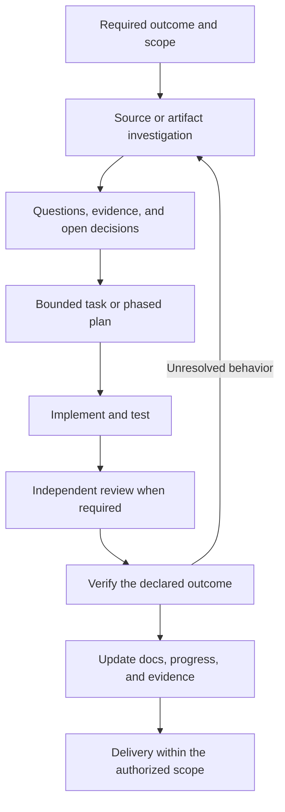

# Working with an AI agent, plans, and REA

## Responsibility

- Use this guide to turn an investigation or repository change into a reviewable result.
- REA supplies analysis operations, Evidence, comparisons, and verification contracts.
- The coding agent chooses questions, calls tools, interprets results, and writes code and tests.
- The project owner defines the required outcome and decides product scope and operational authority.
- The shipped [`reverse-engineer-anything` skill](https://github.com/Global-Platforms-Labs/rea/tree/main/.agents/skills/reverse-engineer-anything) explains how an agent selects and uses REA operations.
- Optional planning skills mentioned below are contributor-installed workflows. REA does not install them, create project plans automatically, or require them for analysis.
- For this public fork, use [fork maintenance](fork-maintenance.md) for source builds and upstream synchronization. Keep project-specific access and environment details outside public documentation.

## Choose the starting point

| Task                                                 | Starting point                                                                             | Evidence needed                                                                           |
| ---------------------------------------------------- | ------------------------------------------------------------------------------------------ | ----------------------------------------------------------------------------------------- |
| Explain a complete source repository                 | Read its source, tests, configuration, and existing docs                                   | File and symbol references; runtime checks only for runtime claims                        |
| Understand a shipped app without its original source | Identify the exact package or executable and choose a supported REA route                  | Artifact identity, analysis results, locations, limitations                               |
| Explain an observed failure                          | Identify the affected version, input, environment, and observed outcome                    | Relevant static facts plus bounded runtime observations                                   |
| Rebuild a feature or service                         | Define the behavior to preserve and its acceptance boundary                                | Original behavior, explicit obligations, candidate implementation, comparable experiments |
| Change REA itself                                    | Read [architecture](overview.md), [tool design](tool-design.md), and [testing](testing.md) | Source changes, affected public contracts, appropriate checks                             |

## Create a useful task brief

| Field             | Record                                                                 |
| ----------------- | ---------------------------------------------------------------------- |
| Outcome           | The user-visible behavior or question to resolve                       |
| Target            | Repository revision, package digest, selected process, or explicit URL |
| Existing behavior | Contracts, identities, and state that must remain compatible           |
| Scope             | Required work and explicit exclusions                                  |
| Authority         | Permitted filesystem, process, network, UI, and deployment effects     |
| Acceptance        | The observation or test that demonstrates the outcome                  |
| Unknowns          | Missing facts, their effect on the task, and the next evidence needed  |

- Resolve codebase-answerable questions through source and evidence.
- Ask the owner for a material product, policy, or operational decision that the available context does not settle.
- Carry already established authorization forward. A plan or tool being available does not authorize unrelated effects.
- For a small bounded change, the brief and relevant checks can be sufficient.
- Use a persistent plan when coordination, dependencies, or multiple sessions require it.
- When changing REA capabilities, follow [contribution scope](https://github.com/Global-Platforms-Labs/rea/blob/main/CONTRIBUTING.md#contribution-scope). Target execution, injection, mutation and protection-recovery integrations have a maintainer scope decision before substantial implementation for integration.

## Plan, implement, and review

The following artifact layout is an optional project workflow. In the REA repository, local planning artifacts are not committed; follow [repository guidance](https://github.com/Global-Platforms-Labs/rea/blob/main/AGENTS.md).

| Stage                 | Artifact or action                                         | Responsibility and completion condition                                                                           |
| --------------------- | ---------------------------------------------------------- | ----------------------------------------------------------------------------------------------------------------- |
| Discover              | Current source, docs, tests, artifact or runtime evidence  | The agent establishes facts and records material unknowns                                                         |
| Define the plan       | `plans/<name>/plan.md`                                     | The primary agent records the confirmed outcome, constraints, requirements, acceptance, and necessary phases      |
| Define phases         | `phases/phase-N.md`                                        | Each phase states what and why, prerequisites, deliverables, and acceptance                                       |
| Track progress        | `todo.md`                                                  | Pending, active, completed, and blocked work remain tied to the active phase                                      |
| Review the plan       | `reviews/`                                                 | A reviewer checks the plan against the requested outcome and evidence; findings do not count as implemented fixes |
| Plan implementation   | `implementation/phase-N-impl.md`                           | A separate pass grounds the phase in current files, symbols, dependencies, and verification commands              |
| Execute               | A bounded change and its checks                            | The implementer follows the agreed phase or brief and preserves relevant existing behavior                        |
| Review implementation | Findings tied to code and acceptance                       | The primary resolves accepted defects and verifies the resulting change                                           |
| Close or continue     | Updated docs, plan status, and evidence                    | Completion reflects actual checks; unresolved acceptance remains explicit                                         |
| Resume later          | Plan, todo, available handover, phase, implementation plan | The next agent rechecks current state before continuing                                                           |

Optional skill mapping:

| Skill                                   | Purpose                                                    |
| --------------------------------------- | ---------------------------------------------------------- |
| `create-plan`                           | Author the outcome, phase scope, and todo artifacts        |
| `review-plan`                           | Independently review plan scope and completeness           |
| `author-and-verify-implementation-plan` | Ground one phase's implementation approach in current code |
| `review-implementation-plan`            | Review that implementation approach                        |
| `execute-work-package`                  | Execute a bounded implementation unit                      |
| `review-implementation`                 | Review the implemented result against its requirements     |
| `update-docs` / `generate-docs`         | Maintain existing docs or create missing documentation     |
| `update-plan`                           | Synchronize actual progress and accepted decisions         |
| `resume-plan` / `generate-handover`     | Recover context or preserve it for a later session         |

- Read the installed skill before invoking it; its exact workflow can change independently of REA.
- When using the two-pass planning workflow, author phase implementation plans in dependency order.
- The optional `execute-work-package` workflow requires the full set of implementation plans before sequential phase execution. Each work package uses a proposed step list, primary-agent review, execution in the same worker session, and a result digest.
- That primary-agent review is an internal coordination step. It does not add a new user permission request for already authorized work.
- Delegate independent scopes with explicit file ownership and a shared baseline.
- A reviewer should receive the authoritative artifacts and evidence, without being asked to confirm the author's conclusion.
- Apply accepted findings within scope. Repeated review rounds do not establish runtime correctness.
- A further review is a deliberate decision based on the task or new evidence, not an automatic loop until a preferred verdict appears.
- Keep authoring, review, execution, and acceptance results distinguishable.

## Investigate with REA

1. **Identify the target.** Retain its path or URL, artifact identity, selected version, and relevant environment.
2. **Choose the operation from the question.** Start with the supplied target; use session availability when a capability is uncertain.
3. **Read the result and its limits.** Preserve the complete Evidence or a valid retained reference.
4. **Follow a specific gap.** Inspect a function, trace a relationship, compare versions, or capture a declared runtime scenario.
5. **Keep observation types separate.** Static reachability, observed execution, inferred behavior, and causal explanations have different evidence requirements.
6. **Save the investigation.** Export Evidence needed by another process or session; a same-session retained reference is not a portable file.

| Target                                 | Applicable route                                                                           | Boundary                                                                                    |
| -------------------------------------- | ------------------------------------------------------------------------------------------ | ------------------------------------------------------------------------------------------- |
| JavaScript directory or Electron ASAR  | `analyze_javascript_application`, then focused views or traces                             | Static relationships do not prove execution                                                 |
| Native executable or library           | `open_binary`, then supported native operations                                            | Requires a matching configured provider                                                     |
| .NET PE/CLI assembly                   | `inspect_managed_artifact`                                                                 | This is not a JVM/JAR decompiler                                                            |
| Java or Scala JAR                      | Archive inventory; configured JEB operations when supported, or an external JVM decompiler | Archive recognition alone does not recover method behavior; retain external tool provenance |
| Android APK                            | Android package/class/method operations                                                    | Requires the documented Android provider prerequisites                                      |
| Browser or Electron runtime            | Target discovery and selected observation/capture operation                                | Captures establish only the observed target, actions, and interval                          |
| Command-line program or test probe     | Process capture and capture comparison                                                     | Capturing a command is not a sandbox or dependency emulator                                 |
| Go, Rust, Flutter or IL2CPP artifact   | The matching metadata/AOT inspection family                                                | Returned facts cover the supported format/profile; they do not imply full source recovery   |
| Packet/signal recording or SQLite file | The matching recorded-data inspection family                                               | Check host/tool prerequisites and snapshot/resource limits; this is not live acquisition    |
| Debugger, Cutter or Frida target       | An explicitly selected command, debugger session or script                                 | Execution, injection and mutation require their own scope; console/script effects are broad |
| Captured web behavior for an agent     | Serve or export a retained agent environment                                               | A recorded environment serves retained evidence; it does not reproduce an unknown backend   |

- For [GGUF/safetensors](model-artifacts.md), use `inspect_model_artifact` for declarations and retained queries. A default header digest does not identify weights; declarations do not establish inference behavior or quality.

Further details: [CLI and Evidence](cli.md), [JEB](jeb-analysis.md), [managed analysis](managed-code-analysis.md), [application workflows](javascript-application-workflows.md), [process capture](process-capture.md).

- Other routes: [language/package map](overview.md#modules), [recorded data](pcap-analysis.md), [tool integrations](reverse-engineering-tools.md), [Frida](frida-instrumentation.md), [agent environments](agent-environments.md).
- Keep resource lifetime in the owning service or provider. Follow [lifecycle rules](tool-design.md#own-the-lifecycle) and preserve retryable ownership when cleanup fails.

## Reconstruct and compare behavior

1. **Freeze the reference.** Identify the original artifact, dependencies, relevant configuration, and data schema.
2. **Write behavior obligations.** Map each required behavior to supporting evidence and an implementation owner.
3. **Design the verifier.** Select inputs, initial state, observed effects, error cases, and an explicit comparison boundary.
4. **Establish a baseline.** Run the original repeatedly under controlled conditions to identify instability and incidental differences.
5. **Implement the candidate.** Keep the original as a reference; test the candidate's own implementation.
6. **Run comparable experiments.** Reset dependencies and state consistently before comparing the original and candidate.
7. **Inspect differences.** Preserve meaningful identity, type, ordering, error, and state differences when normalizing incidental values.
8. **Verify the claim.** Use the comparison's supported dimensions and Evidence to assess the declared behavior.
9. **Evaluate coverage.** Associate supported results with the required surfaces, owners, package proofs, and residual unknowns.

| Mechanism                          | What it establishes                                                 |
| ---------------------------------- | ------------------------------------------------------------------- |
| Artifact inventory                 | Identity and admitted package contents                              |
| Reconstruction obligation ledger   | Required behavior, supporting facts, ownership, and missing proof   |
| Process or browser capture         | Observations from one declared execution                            |
| Capture comparison                 | Differences within the selected, comparable observation dimensions  |
| `verify_reconstruction`            | A scoped claim evaluated against supplied comparison Evidence       |
| `evaluate_reconstruction_coverage` | Readiness within the declared boundary and supplied proof records   |
| Real integration acceptance        | Behavior with the actual external systems and intended user journey |

- A verifier or probe must be implemented and reviewed; REA does not infer a complete test suite from a package.
- If a probe summarizes HTTP responses, database changes, or external calls into terminal output, a terminal comparison depends on that probe's correctness and coverage.
- Preserve the full case results behind a summary or digest. Equal summaries do not explain omitted behavior.
- Process trees and timing can differ between language runtimes even when a selected behavior matches.
- `unknown`, unsupported, or truncated observations do not establish a pass.
- The public obligation ledger accepts authenticated proof records, but the current shipped tools do not produce `rea.reconstruction-proof` records through `verify_reconstruction_obligations`. Do not fabricate them or require automatic ledger closure as though that producer existed.
- Successful declared claims do not establish unrestricted equivalence of two programs.

See [obligation ledgers](reconstruction-obligation-ledgers.md), [process comparisons](process-capture.md), and [MCP contracts](mcp-contracts.md).

## Verification and delivery

- For documentation changes, validate references and run the applicable documentation checks.
- For REA code changes, select checks from [testing](testing.md) and the [contribution guide](https://github.com/Global-Platforms-Labs/rea/blob/main/CONTRIBUTING.md).
- For provider claims, record the actual engine, host, target, and operation tested.
- Report simulated tests, real-provider tests, runtime acceptance, and unavailable coverage separately.
- Update existing documentation after implementation; keep planned architecture explicitly planned until delivered.
- Record completed work only when its acceptance evidence exists.
- Follow the project's established review and delivery authority. Passing tests alone does not authorize deployment or publication.
- Follow [PR ownership and readiness](https://github.com/Global-Platforms-Labs/rea/blob/main/CONTRIBUTING.md#pull-request-ownership-and-readiness). Human review and readiness declarations must come from the human owner; an agent cannot attest to them.

## Continuing an investigation

- Read the goal and current plan, todo, available handover, active phase, and implementation plan.
- Check the working tree and revision before relying on earlier file references.
- Import the saved Evidence bundle when the investigation requires previous records.
- Recheck temporal facts such as deployed versions, provider availability, and external access when they affect the next action.
- Carry unresolved questions forward with their evidence requirements.
- Leave a concise handover containing the current state, decisions, verification, remaining work, and the next concrete action.
